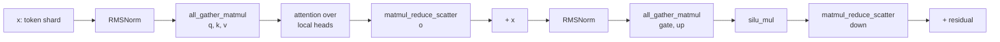

# Tensor Parallelism

## Abstract

d9d has a `tp` dimension in its device meshes, but no layer can use it, and every model rejects `tensor_parallel > 1`. The `ParameterRuntime` of DEP-0013 swaps plain local tensors into modules, so the `DTensor` styles of PyTorch cannot run in d9d.

This DEP adds tensor parallelism with sequence parallelism always on. Between layers, each rank of a tensor-parallel group holds its own share of the tokens. Layers that mix tokens gather them inside their own matrix multiplications, with plain local tensors and explicit collectives. Symmetric memory can overlap that communication with compute. The runtime keeps its gradient rule, and data parallelism composes on top.

## Motivation

*   **Activations of long sequences**: FSDP shards parameters, gradients and optimizer states, but every rank holds the activations of its whole microbatch. With activation checkpointing of every layer, Qwen3-32B still saves 64 layer inputs of 5120 bf16 values per token, 640 KiB. A sequence of 128k tokens then needs 80 GiB, as much as an H100 holds. d9d has no context parallelism. With 1F1B schedules, the first pipeline stage holds `1 / pp` of the layers for `pp` microbatches in flight, so it saves no memory.
*   **Small batches on many GPUs**: Every data-parallel rank needs at least one microbatch per step. A step of 16 sequences can therefore use at most 16 GPUs for data parallelism. Pipeline parallelism adds GPUs, but it needs several microbatches per step to keep its stages busy.

Tensor parallelism solves both: a group of `tp` GPUs computes one microbatch, and each GPU saves `1 / tp` of its layer inputs.

## Design Proposal

### Token shards

A model with tensor parallelism flattens the tokens of a microbatch to `(num_tokens, hidden_size)`, with `num_tokens = batch * seq_len`. Rank `t` of the tensor-parallel group holds rows `[t * num_tokens / tp, (t + 1) * num_tokens / tp)`. This DEP calls them the token shard of the rank.

The tokens are flattened, not split along `seq_len`, because the fused operations of PyTorch gather along dim 0. A gather along `seq_len` of `(batch, seq_len, hidden_size)` copies the tensor for every `batch > 1`, and padded microbatches have `batch > 1`.

`num_tokens` must divide by `tp`. The backbone checks it and raises with a hint: pad the microbatch with `pad_to_multiple_of` of `pad_stack_1d()`.

Token-wise modules need no change: norms, residuals, the embedding lookup and MoE layers compute on the token shard as on any other set of tokens. A module that mixes tokens, such as attention, must gather them. `GroupedQueryAttention` checks that its input has the layout of its mode. A layer that tensor parallelism missed therefore raises instead of attending within the token shard. One Qwen3 layer computes:



### Gradients

The runtime sums the gradient of a parameter over every `Replicate` dimension and leaves other `Shard` dimensions to the layer. This rule stays correct with token shards, because each rank applies a replicated parameter to its own part of the work:

*   **Column-parallel and row-parallel weights**: A column-parallel weight is `Shard(0)` along `tp`, e.g. q, k, v, gate and up. A row-parallel weight is `Shard(1)`, e.g. o and down. Both see all tokens of their part of the layer. Their gradients are complete, and the layer owns `tp`.
*   **Replicated weights on token shards**: Norms, embeddings, heads, routers and experts see only the token shard. Their gradients are partial, and the sum over `tp` completes them.
*   **Replicated weights on local heads**: q and k norms see all tokens, but only the local heads. Their gradients are also partial, and the sum completes them.

The rule therefore holds while the ranks split the work on each replicated parameter, by tokens or by heads, without overlap. `gather_tokens()` and `reduce_tokens()` below return the same values on every rank. After them, the computation must apply no parameter and draw no random numbers. Otherwise every rank would compute the same full gradient, and the sum over `tp` would multiply it by `tp`. The runtime cannot detect this, so the documentation and the tests of every head state the invariant.

Every parameter must therefore be a `DTensor` with `tp` in its mesh: a `Shard` placement if its layer splits it, `Replicate` otherwise. A parameter without `tp` would keep a partial gradient. When `tensor_parallel > 1`, `ModelStageFactory` rejects a plain tensor parameter and a parameter whose mesh lacks the `tp` dimension.

### Primitives

This DEP introduces the package `d9d.parallel.tensor_parallel`. Its primitives compute on plain local tensors and have their own autograd functions:

```python
@dataclasses.dataclass(frozen=True, slots=True)
class TensorParallelGroup:
    """The tensor-parallel ranks of a module and how they communicate.

    Attributes:
        group: The process group of the tensor-parallel ranks.
        async_min_tokens: The smallest microbatch, in tokens before sharding, that uses asynchronous
            communication. ``None`` never uses it, and ``0`` always does.
    """

    group: ProcessGroup
    async_min_tokens: int | None


def all_gather_matmul(
    tokens: Tensor, weights: Sequence[Tensor], biases: Sequence[Tensor | None], tp: TensorParallelGroup
) -> list[Tensor]:
    """Gathers the token shards of the group and applies each column-parallel weight to all tokens.

    Args:
        tokens: The token shard of this rank. Shape: ``(num_local_tokens, in_features)``.
        weights: The local rows of each weight. Shape of each: ``(local_out_features, in_features)``.
        biases: The local part of the bias of each weight, or ``None``. Shape of each: ``(local_out_features,)``.
        tp: The tensor-parallel group.

    Returns:
        One output per weight, for all tokens. Shape of each: ``(num_tokens, local_out_features)``.
    """


def matmul_reduce_scatter(inputs: Tensor, weight: Tensor, bias: Tensor | None, tp: TensorParallelGroup) -> Tensor:
    """Applies a row-parallel weight and sums the results of the group into token shards.

    Args:
        inputs: The local features of all tokens. Shape: ``(num_tokens, local_in_features)``.
        weight: The local columns of the weight. Shape: ``(out_features, local_in_features)``.
        bias: The bias, which every rank holds in full and adds to its token shard, or ``None``.
            Shape: ``(out_features,)``.
        tp: The tensor-parallel group.

    Returns:
        The token shard of this rank. Shape: ``(num_local_tokens, out_features)``.
    """


def local_tokens(values: Tensor, tp: TensorParallelGroup) -> Tensor:
    """Returns the token shard of this rank from values that every rank holds in full.

    Args:
        values: Values without a gradient, e.g. token ids or labels. Shape: ``(num_tokens, ...)``.
        tp: The tensor-parallel group.

    Returns:
        The rows of this rank. Shape: ``(num_local_tokens, ...)``.

    Raises:
        ValueError: If the values require a gradient, or if ``num_tokens`` does not divide by the group size.
    """


def gather_tokens(tokens: Tensor, tp: TensorParallelGroup) -> Tensor:
    """Gathers the token shards of the group. The backward pass keeps the gradient of the own shard.

    Args:
        tokens: The token shard of this rank. Shape: ``(num_local_tokens, ...)``.
        tp: The tensor-parallel group.

    Returns:
        All tokens. Shape: ``(num_tokens, ...)``.
    """


def reduce_tokens(values: Tensor, tp: TensorParallelGroup) -> Tensor:
    """Sums values over the group. The backward pass passes the gradient through.

    Args:
        values: The part of this rank, with zeros where other ranks contribute.
        tp: The tensor-parallel group.

    Returns:
        The sum over the group, with the shape of ``values``.
    """
```

The backward passes follow from the invariant. After `gather_tokens()`, every rank computes the same loss, so every rank gets the same gradient of the gathered tokens. Each rank keeps its own rows. A reduce-scatter there would add up `tp` equal copies. `reduce_tokens()` sums rows that only one rank filled, so its gradient also needs no communication.

The two matrix-multiplication primitives work with split backward (#147). They check each gradient direction with `needs_input_grad()`, as grouped matrix multiplication does:

*   **Column-parallel input gradient**: One reduce-scatter of `cat(dY_1, ..., dY_n) @ cat(W_1, ..., W_n)` for all weights.
*   **Column-parallel weight gradient**: The forward pass saves only the token shard, and the weight pass gathers the tokens again.
*   **Row-parallel input gradient**: One gather of the output gradient, fused with its multiplication. The fused operation also returns the gathered gradient.
*   **Row-parallel weight gradient**: The weight pass reuses the gathered output gradient from the input pass. When the input is frozen, no input pass runs, so the weight pass gathers the output gradient itself. Only a trainable weight keeps the gathered output gradient, and its weight pass frees it.

The two weight passes differ because of lifetime. A forward pass would save the gathered tokens of every layer until the backward pass of that layer, `tp` times the input of each block. The gathered output gradient lives only between the input pass and the weight pass of one block. Split backward schedules can delay a weight pass, and the gradient waits that long.

### Asynchronous communication

Asynchronous communication overlaps a gather or a reduce-scatter with the matrix multiplication that uses it, through symmetric memory: `torch.ops.symm_mem.fused_all_gather_matmul` and `fused_matmul_reduce_scatter`. The ranks copy the chunks over NVLink with the copy engines while the matrix multiplication runs. Synchronous communication calls NCCL collectives and then the matrix multiplication.

Asynchronous communication pays off only for long microbatches. The table compares the two modes on a draft of the column-parallel primitive, on 8 H100 GPUs in one node, in bf16. Each cell divides the synchronous time by the asynchronous time, so values above 1 favor asynchronous communication. The time covers the forward pass and the input gradient, and the asynchronous time includes the weight concatenation. The weight gradient is the same in both modes. Each cell is the median of one run, so single cells are noisy.

| Qwen3 projection | Tokens | `tp = 2` | `tp = 4` | `tp = 8` |
|:-----------------|-------:|---------:|---------:|---------:|
| 8B q, k, v       |     4k |     0.72 |     0.55 |     0.46 |
| 8B q, k, v       |    16k |     1.32 |     1.01 |     0.86 |
| 8B q, k, v       |    64k |     1.35 |     1.55 |     1.45 |
| 8B gate, up      |     4k |     0.96 |     0.84 |     0.73 |
| 8B gate, up      |    16k |     1.03 |     1.24 |     1.41 |
| 8B gate, up      |    64k |     1.03 |     1.15 |     1.45 |
| 32B q, k, v      |     4k |     1.10 |     1.04 |     0.69 |
| 32B q, k, v      |    16k |     1.12 |     1.52 |     1.37 |
| 32B q, k, v      |    64k |     1.26 |     1.48 |     1.57 |
| 32B gate, up     |     4k |     0.94 |     1.01 |     0.98 |
| 32B gate, up     |    16k |     1.02 |     1.09 |     1.09 |
| 32B gate, up     |    64k |     0.99 |     1.05 |     1.10 |

The gain grows with the token count and with `tp`. It shrinks where the multiplication dominates, as in the MLP of Qwen3-32B. Short microbatches run up to two times slower. The microbatches of one job differ in length, so a flag is not enough.

`async_min_tokens` is a threshold on the token count of the microbatch, before sharding. The primitives compare it at every call. Every rank of the tensor-parallel group has the same token count and the same threshold, so all ranks take the same path without communication. The result depends only on the microbatch, so runs repeat exactly. Attention and MLP cross over at different lengths, so each module gets its own threshold.

The primitives pass one weight to each fused operation. They keep separate parameters and concatenate the weights of a call, e.g. q, k and v, in forward and in backward. Checkpoints and the Hugging Face mappers stay unchanged. The reduce-scatter accepts only one weight, and one weight is also faster than a list in the gather for short microbatches. The copies cost 0.5% of the projection time at 64k tokens, and 3-8% at 4k tokens.

Symmetric memory needs CUDA peer access between all ranks of the tensor-parallel group, e.g. inside one node. `parallelize_tensor_parallel()` sets up the symmetric memory of the group when `async_min_tokens` is not `None`. Setup performs a symmetric-memory rendezvous, so unsupported peer access fails before the first step.

[PyTorch](https://github.com/pytorch/pytorch/blob/v2.14.0/torch/distributed/_symmetric_memory/__init__.py) caches the symmetric memory of a process group by the group name, and destroying the group does not clear the cache. Names repeat when a process destroys the default group and creates new groups, e.g. in two `init_dist_context()` blocks in a row. Only the first such block can use asynchronous communication. This is a stopgap: PyTorch has no API to free these resources.

### Modules

This DEP introduces `ModuleSupportsTensorParallel` and `parallelize_tensor_parallel()` in `d9d.parallel.tensor_parallel`:

```python
class ModuleSupportsTensorParallel(typing.Protocol):
    """Protocol for modules that compute on token shards with tensor parallelism."""

    def tensor_parallel_placements(self) -> Mapping[str, Placement]:
        """Returns the placement along ``tp`` of each parameter that the module splits.

        The keys are names from ``named_parameters()``. The other parameters stay as they are.
        """

    def enable_tensor_parallel(self, tp: TensorParallelGroup):
        """Switches the module to token shards and the communication of ``tp``.

        Raises:
            ValueError: If the module cannot split its computation into ``tp.group.size()`` parts.
        """


def parallelize_tensor_parallel(
    module: ModuleSupportsTensorParallel, mesh: DeviceMesh, async_min_tokens: int | None = None
):
    """Places the parameters of a module for tensor parallelism and switches the module to token shards.

    A mesh of size 1 changes nothing.

    Args:
        module: The module.
        mesh: The one-dimensional mesh of the tensor-parallel ranks.
        async_min_tokens: The threshold of asynchronous communication, see ``TensorParallelGroup``.

    Raises:
        ValueError: If a parameter to split is already a ``DTensor``, its split dimension is not divisible
            by the group size, or ``async_min_tokens`` is negative.
        RuntimeError: If asynchronous communication cannot set up the symmetric memory of the group.
    """
```

This DEP supports equal TP shards. Before replacing parameters, `parallelize_tensor_parallel()` checks that each dimension to split is divisible by the group size. Data parallelism can still create uneven shards within each TP shard.

The pattern follows `MoELayer.enable_distributed_communicator()`: the module gets a process group, but never reads a device mesh. The d9d modules implement the protocol:

*   **`GroupedQueryAttention`**: The q, k, v and output gate weights are column-parallel, and o is row-parallel. Each rank computes its own heads. The query and key-value head counts must divide by `tp`. The layer reads `(batch, seq_len)` from the rotary embeddings, which every rank holds in full, to restore the sequences after the gather.
*   **`SwiGLU`**: The gate and up weights are column-parallel and share one `all_gather_matmul()`, and down is row-parallel.
*   **Backbones**: `Qwen3DenseModel` and `Qwen3MoEModel` take the token shard of `input_ids`, pass token shards between stages and aggregate hidden states over the tensor-parallel group.
*   **`SplitLanguageModellingHead`**: It computes CCE on the token shard with the token shard of the labels, then gathers the losses.
*   **`ClassificationHead` and `EmbeddingHead`**: The pooling mask selects positions in `(batch, seq_len)` order. Every rank holds the full mask, so it knows the global index of each of its selected tokens. It applies the head to them and writes the results to their rows of a zero tensor. `reduce_tokens()` then assembles all rows. Without a pooling mask, the head gathers its outputs.

A module that wraps its projections, e.g. with LoRA adapters, would be bypassed, because the primitives read the weights directly. `enable_tensor_parallel()` rejects a projection that is not an `nn.Linear`.

The hidden states aggregator sums the masked hidden states of the token shard. It divides them by the token count of the full mask. In `pack()`, it reduces the stacked results over the tensor-parallel group once, in fp32, before it prepends the incoming snapshot. Between pipeline stages, the transfer holds the token shard, so `stage_transfer_spec()` describes `(num_tokens / tp, hidden_size)`.

The model parallelizers place every module of the model:

```python
def parallelize_qwen3_dense_model(
    dist_context: DistributedContext,
    model: Qwen3DenseModel,
    stage: PipelineStageInfo,
    attention_async_min_tokens: int | None = None,
    mlp_async_min_tokens: int | None = None,
):
    """Parallelizes a Qwen3 Dense backbone within one pipeline stage.

    Args:
        dist_context: The distributed context.
        model: The Qwen3 Dense backbone to parallelize.
        stage: The current pipeline stage.
        attention_async_min_tokens: The threshold of asynchronous communication in attention layers.
        mlp_async_min_tokens: The threshold of asynchronous communication in MLP layers.
    """
```

`parallelize_qwen3_moe_model()` takes only `attention_async_min_tokens`, because its MoE layers compute on token shards. The head parallelizers of `d9d.models` enable tensor parallelism on their heads. All of them, and `parallelize_expert_parallel()`, place parameters on meshes with `tp`.

### Data parallelism over tensor parallelism

Tensor parallelism places the parameters first. `parallelize_hsdp()` and `parallelize_replicate()` then accept parameters that are already `DTensor` objects. Their mesh must contain `tp` and come from the same root mesh. They keep the placements along `tp` and add their own along the other dimensions. They build the new local tensor from the existing local tensor, so no rank needs the global tensor. `parallelize_tensor_parallel()` rejects the opposite order.

`parallelize_fsdp()` keeps its one-dimensional mesh. FSDP over TP uses `parallelize_hsdp()` over the data shard dimension and `tp`.

When both shard dim 0, the data shard dimension gets `_StridedShard(0, split_factor=tp)`, as in FSDP2. `Shard(0)` there would split the full rows first, so the data shards would cross the boundaries of the TP blocks. With equal TP shards, this placement preserves the TP blocks when data parallelism splits them. The gather along the data shard dimension returns the rows of the TP block of the rank. The data shard of a row-parallel weight is a plain `Shard(0)`, because tensor parallelism splits dim 1.

The runtime and the gradient norm then change in four places:

*   **Axis roles**: A gathered parameter can also be split along other dimensions. `classify_axes()` and `split_placement_dims()` accept `_StridedShard`, which is not a subclass of `Shard` in PyTorch.
*   **Unsharded shape**: The gathered weight has the local shape along the dimensions of its layer, e.g. `(out_features / tp, in_features)`, not the global shape.
*   **Shard sizes**: The runtime takes the size of the data shard of each rank from the placements, as PyTorch computes it. It no longer assumes chunks of the global shape, which do not match `_StridedShard` for uneven sizes.
*   **Gradient norm**: The norm of a parameter sharded along several mesh dimensions is reduced over all of them.

`distribute_tensor()`, `DTensor.full_tensor()` and Distributed Checkpoint support `_StridedShard`, so checkpoints and the Hugging Face mappers need no change.

### Random numbers

With token shards, every rank of a tensor-parallel group holds other tokens or other heads, so it needs other dropout masks. The compute fork of DEP-0011 becomes `("cp", cp, "tp", tp, kind, stage, microbatch)` of `("dp", dp)`. After `gather_tokens()` and `reduce_tokens()`, the computation draws no random numbers, by the invariant above.

### Memory

Symmetric memory keeps one workspace per process group. PyTorch allocates it outside the caching allocator and keeps the largest size that a fused operation requested, in forward or in backward. The reduce-scatter requests two token shards of its output, e.g. 64 MiB for 32k tokens, `hidden_size` 4096, bf16 and `tp = 8`. The gather requests one token shard of its input. Up to 2048 tokens, on GPUs with multicast, it requests the full gathered input instead, at most 16 MiB for `hidden_size` 4096 in bf16.

`torch.cuda.memory_allocated()` and the memory budget of the runtime do not count the symmetric workspace. `TrainSleeper.sleep()` does not free it, like the buffers of NCCL. Freeing both belongs to `SleepTag.COMMS`.

### Verification

The implementation must keep the following measurable, with the commands and the configuration in the PR:

*   **Correctness**: Qwen3 Dense and Qwen3 MoE with `tp` 2 and 4 match one device within the tolerances of `d9d_dev`. The comparisons cover composition with FSDP, HSDP and PP. This holds for synchronous and asynchronous communication, full and split backward, activation checkpointing, every head and uneven data shards. Pooling cases include ranks with no selected tokens. Dropout is off in these comparisons, because the masks depend on `tp`. A Hugging Face checkpoint loads and exports back unchanged.
*   **Partial training**: The primitives match eager gradients when inputs or weights are frozen, including training only a row-parallel projection. This holds for full and split backward.
*   **Placement validation**: A split dimension not divisible by `tp` is rejected before parameter replacement. Even TP shards compose with uneven data shards and round-trip through a checkpoint.
*   **Gradient lifetime**: The weight pass of a row-parallel block frees the gathered output gradient, even while the caller keeps the forward output. A frozen weight keeps no gathered output gradient.
*   **Performance**: Steady-state step time with its spread and peak memory against the base commit, for synchronous and asynchronous communication. Test `tp` 1, 2, 4 and 8 where the model supports them. The report names the model, the topology, the dtype, the sequence lengths and the thresholds. It also calibrates the thresholds that the documentation recommends. Memory measurements include allocator peaks and device memory outside the allocator, including the retained symmetric workspace.

## Usage

A Qwen3 job sets the degree in the mesh config and the thresholds in its provider:

```yaml
mesh:
  data_parallel: 4
  tensor_parallel: 2
  dense:
    data_parallel_shard: 4
```

```python
def parallelize_model_stage(self, context: ParallelizeModelStageContext[Qwen3DenseForCausalLM]):
    parallelize_qwen3_dense_model(
        context.dist_context,
        context.model.model,
        context.stage,
        attention_async_min_tokens=16384,
        mlp_async_min_tokens=8192,
    )
    if context.stage.is_current_stage_last:
        parallelize_causal_lm_head(context.model.head, context.dist_context)
```

A custom block computes with the primitives:

```python
from d9d.parallel.tensor_parallel import TensorParallelGroup, all_gather_matmul, matmul_reduce_scatter


class GeluMLP(nn.Module):
    def __init__(self, hidden_size: int, intermediate_size: int):
        super().__init__()
        self.up = nn.Linear(hidden_size, intermediate_size, bias=False)
        self.down = nn.Linear(intermediate_size, hidden_size, bias=False)
        self._tp: TensorParallelGroup | None = None

    def tensor_parallel_placements(self) -> Mapping[str, Placement]:
        return {"up.weight": Shard(0), "down.weight": Shard(1)}

    def enable_tensor_parallel(self, tp: TensorParallelGroup):
        self._tp = tp

    def forward(self, x: torch.Tensor) -> torch.Tensor:
        if self._tp is None:
            return self.down(F.gelu(self.up(x)))
        (hidden,) = all_gather_matmul(x, [self.up.weight], [None], self._tp)
        return matmul_reduce_scatter(F.gelu(hidden), self.down.weight, None, self._tp)
```

The provider of a custom model enables tensor parallelism on the backbone and on every module that mixes tokens or splits weights. It then places the data parallelism over a mesh with `tp`:

```python
mesh = context.dist_context.mesh_for(DENSE_DOMAIN)
tp_mesh = mesh[DenseDim.TP]
dp_tp_mesh = mesh[DenseDim.DP_REPLICATE, DenseDim.DP_CP_SHARD, DenseDim.CP_REPLICATE, DenseDim.TP]

parallelize_tensor_parallel(context.model, tp_mesh)
for layer in context.model.layers.values():
    parallelize_tensor_parallel(layer.self_attn, tp_mesh, async_min_tokens=16384)
    parallelize_tensor_parallel(layer.mlp, tp_mesh, async_min_tokens=8192)
parallelize_hsdp(context.model, mesh=dp_tp_mesh, shard_dim=DenseDim.DP_CP_SHARD)
```

## Backward Compatibility

*   **Dropout masks**: The compute fork includes `tp`, so the same seed draws other numbers than before, also with `tp = 1`.
*   **Meshes of parameters**: With `tensor_parallel > 1`, a parameter without `tp` in its mesh is rejected. A custom parallelizer adds `DenseDim.TP` or `ExpertDim.TP` to the meshes it passes.
*   **Custom heads and aggregators**: With `tensor_parallel > 1`, the backbone passes token shards of `(num_local_tokens, hidden_size)`, not `(batch, seq_len, hidden_size)`. A custom head implements `ModuleSupportsTensorParallel`, and a custom aggregator reduces over the tensor-parallel group in `pack()`. Without tensor parallelism, nothing changes.
*   **Sharding**: The runtime now gathers a parameter that another dimension also splits. DEP-0013 rejected it.

## Alternatives Considered

### `DTensor` parallel styles

PyTorch provides `ColwiseParallel`, `RowwiseParallel` and `SequenceParallel`, which run the projections on `DTensor` objects. The runtime swaps plain local tensors into the modules, and the d9d kernels accept only plain tensors. Each operation would also pay the `DTensor` dispatch on the host.

### Tensor parallelism without sequence parallelism

Megatron-Core can replicate the activations between layers. Every rank then computes norms and residuals on all tokens, so their gradients are equal on all ranks, not partial. The runtime would need a separate role for `tp`, and asynchronous communication needs the gather and the reduce-scatter of sequence parallelism anyway. The replicated activations also cost `tp` times the memory.

### Shard the sequence dimension

PyTorch `SequenceParallel` can shard `seq_len` of `(batch, seq_len, hidden_size)`. The fused operations of PyTorch move the gather dimension to the front and copy the tensor when `batch > 1`. Megatron-Core avoids the copy with the layout `(seq_len, batch, hidden_size)`. The d9d modules use `(batch, seq_len, ...)`, so flattened tokens avoid the copy without a new layout.

### Fused q, k, v and gate, up parameters

Megatron-Core keeps one parameter for q, k and v. The fused operations then need no concatenation. The local rows of rank `t` are `[q_t; k_t; v_t]`, not a slice of `[q; k; v]`, so every Hugging Face mapper must reorder rows. LoRA on one projection, e.g. only v, also gets harder. The concatenation costs 0.5-2% of the projections at 16k tokens and more.

### Keep the gathered tokens for the weight gradient

The forward pass can return the gathered tokens of a column-parallel block and save them. The weight pass then needs no gather. Every layer then keeps `tp` times its input from the forward pass to its backward pass. Megatron-Core also gathers again in the weight pass.

### Save a feature shard for the weight gradient

[torchtitan](https://github.com/pytorch/torchtitan/blob/2ffc9fd3f802c8a086eabe8eac555856f2deac4a/torchtitan/models/common/linear/async_linear.py) also uses custom autograd functions with explicit fused operations. Its column-parallel forward saves a feature shard of the gathered input, as large as a token shard. The weight pass gathers the transposed shard with `fused_all_gather_matmul()`, so the gather overlaps the multiplication. The weight pass of this DEP sums over the gathered dimension, so it cannot use the fused gather. The feature shard costs a copy in forward and a transposed copy in backward. Choosing between them requires a benchmark of the forward and both backward passes, including their peak memory.

### One mode for all microbatches

torchtitan enables asynchronous communication with one flag for the job, and Megatron-Core does so with `tp_comm_overlap`. In the table above, short microbatches lose up to half their speed with it, and long ones lose up to a third without it.

### Choose the mode by measurement

A layer could time both modes at run time and keep the faster one. Ranks could choose different modes, and their collectives would wait for each other forever. The results would also depend on timing. An explicit threshold avoids both.

### Asynchronous communication in the mesh config

torchtitan selects the mode in its job config. The d9d mesh config states only sizes, and the strategy of each module is the code of the provider. Attention and MLP also need different thresholds.

### Vocabulary-parallel language modeling head

Megatron-Core splits the vocabulary of the head and of the embedding. With token shards and CCE, the head never materializes the full logits, so the split saves only the weight memory, which FSDP already shards.

## Prerequisites

This DEP builds on the `ParameterRuntime` of DEP-0013 (#143) and its implementation (#151, #152, #153), including split backward (#147).

## Deferred Work

*   **Vocabulary-parallel embedding and head**: They would save the gathered weight memory of large vocabularies. FSDP already shards this memory between steps, so the gain is small.
*   **Expert tensor parallelism**: Splitting the FFN of each expert would reduce its weight memory per rank. Another option places experts over `dp * cp * tp`. It needs a new expert placement and token dispatch, so it gets its own DEP.
*   **Fewer key-value heads than `tp`**: Replicating the key-value heads would allow `tp` beyond the key-value head count. The limit depends on the model. [Qwen3-30B-A3B](https://huggingface.co/Qwen/Qwen3-30B-A3B/blob/main/config.json) and [Qwen3-235B-A22B](https://huggingface.co/Qwen/Qwen3-235B-A22B/blob/main/config.json) have four key-value heads, so this DEP supports them only up to `tp = 4`.
*   **Other token-mixing layers**: MLA and gated DeltaNet need their own implementations. Their models keep rejecting `tensor_parallel > 1`.
*   **Context parallelism**: With CP, token shards split the CP-local sequence. CP does not exist in d9d yet.
*   **LoRA on split projections**: A row-parallel projection needs an all-reduce of the low-rank activations. It needs PEFT layers that know tensor parallelism, so it waits for a user who needs it.
*   **Weight concatenation once per region**: The primitives could concatenate the weights of a region once for all its microbatches. The copies cost at most 2% at 16k tokens, so this waits for a profile that shows it.
*   **Freeing communication resources**: `SleepTag.COMMS` should free the symmetric memory and the NCCL buffers. PyTorch has no public API to free the workspace and the group registrations of the fused operations. Freeing them would also let a process create its groups again with asynchronous communication.
*   **Asynchronous communication between nodes**: Symmetric memory over NVSHMEM could overlap the communication of groups that span nodes. The fused operations of PyTorch need CUDA peer access today.
*   **Default thresholds**: Measured defaults per GPU could replace `None` once real runs calibrate them.
