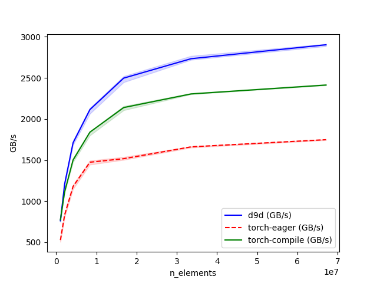

# Mixture of Experts (MoE)

## About

The `d9d.module.block.moe` package implements sparse Mixture-of-Experts layers. `MoELayer` combines a router, a token dispatcher and the experts, with an optional shared expert.

## Expert Parallelism

To set up expert parallelism, see [Horizontal Parallelism](../horizontal_parallelism.md). Expert parallelism requires the `d9d[backend-expert-parallel-deepep]` extra. You must build and install [DeepEP](https://github.com/deepseek-ai/DeepEP) manually first.

## Components

### Router

`TopKRouter` is a learned router that selects the top-k experts for each token. It computes the routing probabilities in fp32 for numerical stability. An optional expert bias changes which experts are selected but not their probabilities. You can use it for loss-free load balancing.

### Token Dispatcher

`ExpertCommunicationHandler` is the interface that moves tokens to their experts and back.

*   `NoCommunicationHandler` is the default. It is used when all experts are local, such as on a single GPU or with tensor parallelism.
*   With expert parallelism, `parallelize_expert_parallel` switches the layer to a DeepEP handler. It runs the all-to-all communication over NVLink and RDMA with [DeepEP](https://github.com/deepseek-ai/DeepEP).

### Experts

`GroupedSwiGLU` holds a set of SwiGLU experts. It does not loop over experts. It runs all experts in one grouped GEMM per projection, for any number of tokens per expert. It computes `SiLU(gate(x)) * up(x)` with a fused Triton kernel.

#### Kernel Benchmarks (bf16, H100)



### Grouped GEMM Backends

`GroupedSwiGLU` runs its projections with `GroupedLinear`, which passes the grouped GEMM to a backend. The available backends are:

| `kind`           | Library                                                     | GPUs        | Extra                                  |
|:-----------------|:------------------------------------------------------------|:------------|:---------------------------------------|
| `"quack"`        | [QuACK](https://github.com/Dao-AILab/quack)                 | sm90+       | `d9d[backend-grouped-mm-quack]`        |
| `"grouped_gemm"` | [grouped_gemm](https://github.com/fanshiqing/grouped_gemm/) | sm80+       | `d9d[backend-grouped-mm-grouped-gemm]` |
| `"torch"`        | PyTorch `grouped_mm`                                        | Any         | -                                      |
| `"eager"`        | Plain PyTorch ops                                           | Any         | -                                      |

The `"quack"` backend compiles its kernels on first use and does not support fp32 on sm90. The `"torch"` backend is fast only for bf16 on sm90 and sm100. The `"eager"` backend has no extra dependencies. Use it as a fallback and as a correctness reference for the other backends.

#### Backend Selection

A layer picks its backend in this order:

1.  The `grouped_mm_backend` configuration passed to `MoELayer`, `GroupedSwiGLU` or `GroupedLinear`.
2.  The `D9D_BACKEND_AUTO_GROUPED_MM` environment variable.
3.  Auto-detection: `"quack"` on sm90+ if it is installed, `"grouped_gemm"` on sm80 if it is installed, `"torch"` on sm90 and sm100, and `"eager"` otherwise.

`D9D_BACKEND_AUTO_GROUPED_MM` holds a backend configuration as JSON, keyed by the `kind` field:

```bash
# Force the grouped_gemm backend.
export D9D_BACKEND_AUTO_GROUPED_MM='{"kind": "grouped_gemm"}'
```

### Shared Experts

A shared expert processes every token, whatever the router chooses. Configure it with `SharedExpertParameters`. It can scale its output with a learned sigmoid gate (`enable_gate`).

## Usage

```python
import torch

from d9d.module.block.moe import MoELayer, SharedExpertParameters

moe = MoELayer(
    hidden_dim=2048,
    intermediate_dim_grouped=768,
    num_grouped_experts=128,
    top_k=8,
    router_renormalize_probabilities=True,
    shared_expert=SharedExpertParameters(intermediate_size=4096, enable_gate=True),
).to(device="cuda", dtype=torch.bfloat16)
moe.reset_parameters()

hidden_states = torch.randn(2, 16, 2048, device="cuda", dtype=torch.bfloat16)
output = moe(hidden_states)  # (2, 16, 2048)

# Number of tokens routed to each expert since the last reset.
print(moe.tokens_per_expert)
moe.reset_stats()
```

## API Reference

::: d9d.module.block.moe

::: d9d.module.block.moe.communications

::: d9d.module.block.moe.grouped_mm
